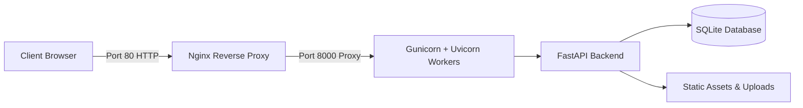

# ಕಲಾಕಟ್ಟೆ · KalaKatte

> A fair-trade digital marketplace connecting coastal and regional Karnataka artisans directly with conscious buyers. Zero middleman margins, transparent artisan-first pricing, and bilingual support (ಕನ್ನಡ & English).

🌐 **Live Website:** [http://kalakatte.duckdns.org](http://kalakatte.duckdns.org) *(Mirror: [http://129.159.239.139](http://129.159.239.139))*

---

## ✨ Features

- **Artisan-First Direct Sales:** Handcrafted GI-tagged and heritage crafts from Karnataka (Kasuti embroidery, Kinnal woodcraft, Chittara murals, Channapatna toys, Terracotta pottery, and more).
- **Transparent Cost Breakdown:** Each product details raw material cost, artisan labor hours, and genuine fair-wage payout.
- **Role-Based Access Control:**
  - **Artisans:** List new handcrafted works, upload product imagery, and manage/ship orders.
  - **Buyers:** Explore collections, learn craft histories, and place orders directly.
- **Bilingual Experience:** Seamless toggling between Kannada (ಕನ್ನಡ) and English.
- **Order Flow:** Instant WhatsApp order confirmation and direct tracking.

---

## 🛠️ Architecture & Tech Stack



- **Frontend:** Responsive vanilla HTML5, CSS3 (Kasuti-inspired palette: Indigo, Red, Mustard, Linen), and modern JavaScript.
- **Backend:** FastAPI (Python 3.9+) with Pydantic v2 data validation.
- **Database:** SQLite with SQLAlchemy ORM.
- **Authentication:** JWT (JSON Web Tokens) with 30-day persistence and bcrypt password hashing.
- **Production Server:** Oracle Cloud Linux (ARM/AMD), Gunicorn process manager, Nginx reverse proxy, and Systemd supervision.

---

## 📁 Repository Structure

```
KalaKatte/
├── index.html                 # Complete responsive frontend web application
├── BACKEND.md                 # Backend technical architecture & API specification
├── README.md                  # Project documentation & overview
└── backend/
    ├── main.py                # FastAPI endpoints, static file & upload handlers
    ├── auth.py                # JWT creation, decoding, and FastAPI dependencies
    ├── database.py            # SQLite engine & database session factory
    ├── models.py              # SQLAlchemy database models (User, Product, Order)
    ├── schemas.py             # Pydantic request/response schemas
    ├── requirements.txt       # Pinned production Python dependencies
    ├── start.sh               # Local development launch script
    ├── deploy.sh              # One-shot Oracle Linux deployment automation
    ├── nginx-kalakatte.conf   # Nginx reverse proxy server block
    └── kalakatte.service      # Systemd service unit definition
```

---

## 🚀 Local Development

### 1. Clone the repository
```bash
git clone https://github.com/ganapatinaik1/KalaKatte.git
cd KalaKatte
```

### 2. Set up the Python environment
```bash
cd backend
python3 -m venv venv
source venv/bin/activate
pip install -r requirements.txt
```

### 3. Start the application
```bash
bash start.sh
# or manually:
uvicorn main:app --reload --port 8000
```

Open [http://localhost:8000](http://localhost:8000) in your browser. The API interactive documentation is available at [http://localhost:8000/docs](http://localhost:8000/docs).

---

## 🌐 Production Deployment

The project includes automated deployment for Oracle Cloud Linux:

```bash
chmod +x backend/deploy.sh
SSH_KEY=~/path/to/ssh-key.key SSH_REMOTE=opc@129.159.239.139 bash backend/deploy.sh
```

---

## 📜 License

MIT License &copy; 2026 KalaKatte Contributors.
